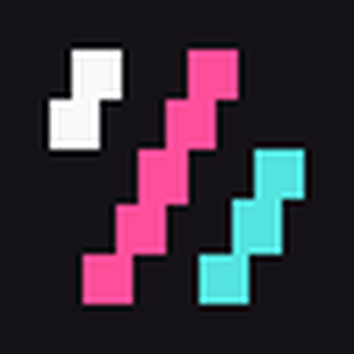

<p align="center">
  <a href="https://kzm.bar">
    
  </a>
</p>

<h1 align="center">Katana Zero Modding</h1>

<p align="center">
  <strong>Same game. New possibilities.</strong><br />
  Знакомая игра. Новые возможности.
</p>

<p align="center">
  KZM is a Windows launcher, a command-line tool, and a Lua SDK<br />
  for installing, playing, and writing Katana ZERO mods.
</p>

<p align="center">
  <a href="https://github.com/KatanaZeroModding/KZM/blob/main/LICENSE"></a>
  <a href="https://github.com/KatanaZeroModding/KZM/blob/main/docs/PLAYING.md"></a>
  <a href="https://kzm.bar"></a>
  <a href="https://ko-fi.com/an1by"></a>
</p>

<p align="center">
  <a href="#play">Play</a> |
  <a href="#create-a-mod">Create a mod</a> |
  <a href="#repositories">Repositories</a> |
  <a href="#how-it-fits-together">How it fits together</a> |
  <a href="https://github.com/KatanaZeroModding/KZM/blob/main/docs/README.md">Documentation</a> |
  <a href="https://kzm.bar">kzm.bar</a> |
  <a href="#ru">По-русски</a>
</p>

New characters, mechanics, and stories start as mods. This organization is the home for that work: the KZM tools, the site, the editor extension, the templates, and the mods built with them.

## Play

1. Take a Windows bundle from [KZM releases](https://github.com/KatanaZeroModding/KZM/releases) when one is published, plus a compatible [`libLassebq.dll`](https://github.com/nkrapivin/libLassebq/releases).
2. Point **kzm-launcher** at the folder that contains `Katana ZERO.exe` and `data.win`. Run **Setup libLassebq base…** once. KZM keeps a backup of that archive.
3. Drop a `.kzm` into the import folder, enable it in a profile, and press **Play**.

[Player guide](https://github.com/KatanaZeroModding/KZM/blob/main/docs/PLAYING.md) · [Инструкция на русском](https://github.com/KatanaZeroModding/KZM/blob/main/README_RU.md) · [Troubleshooting](https://github.com/KatanaZeroModding/KZM/blob/main/docs/TROUBLESHOOTING.md)

KZM needs a legally owned copy of Katana ZERO. The game itself is not part of these repositories. Compatibility with a game edition and with other mods is stated on each mod.

## Create a mod

```bash
kzm init my-mod
kzm build
```

`kzm init --clang` starts from the C template. The [mod author guide](https://github.com/KatanaZeroModding/KZM/blob/main/docs/MODDING.md) covers the manifest, the Lua SDK, localization, and packing a `.kzm`. [KZM for VS Code and Cursor](https://github.com/KatanaZeroModding/kzm-vsx) edits `mod.toml` and runs build and pack from the editor.

[CLI reference](https://github.com/KatanaZeroModding/KZM/blob/main/docs/CLI.md) · [Manifest](https://github.com/KatanaZeroModding/KZM/blob/main/docs/spec/mod.toml.md) · [Build KZM from source](https://github.com/KatanaZeroModding/KZM/blob/main/docs/BUILD.md)

## Repositories

### Platform

| Repository | Role |
| --- | --- |
| [**KZM**](https://github.com/KatanaZeroModding/KZM) | Launcher, `kzm` CLI, Lua runtime and SDK, native plugin host, content-patch pipeline, documentation |
| [**WebSite**](https://github.com/KatanaZeroModding/WebSite) | [kzm.bar](https://kzm.bar) — the public site |
| [**kzm-vsx**](https://github.com/KatanaZeroModding/kzm-vsx) | VS Code / Cursor extension for `mod.toml`, build, and pack |
| [**kzm-api**](https://github.com/KatanaZeroModding/kzm-api) | Published API name index (`kzm-api.json`) for tooling and docs |

### Mods

| Repository | Role |
| --- | --- |
| [**kzm-discord-mod**](https://github.com/KatanaZeroModding/kzm-discord-mod) | Discord Rich Presence: place, track, and character |
| [**kzm-online-mod**](https://github.com/KatanaZeroModding/kzm-online-mod) | Co-op and PVP lockstep over Steam, friends only |
| [**kzm-squick-mod**](https://github.com/KatanaZeroModding/kzm-squick-mod) | Skip the startup prompts and resume a saved speedrun |
| [**kzm-bunker-pistol-mod**](https://github.com/KatanaZeroModding/kzm-bunker-pistol-mod) | The Bunker 2 pistol fires instead of being thrown |

### Templates

| Repository | Role |
| --- | --- |
| [**template-mod**](https://github.com/KatanaZeroModding/template-mod) | `kzm init` — Lua and Rust, MIT |
| [**template-mod-clang**](https://github.com/KatanaZeroModding/template-mod-clang) | `kzm init --clang` — Lua and C, MIT |

## How it fits together

```text
Katana ZERO
  └── KZM
        ├── Profile
        │     └── Enabled mods (.kzm)
        ├── Lua runtime and SDK
        ├── Native plugin host
        └── Content patches the mod declares
```

A profile is one loadout. **Play** deploys that loadout and starts the game. **Restore vanilla** returns the archive saved during setup.

```text
mod.toml
  ├── Lua
  ├── Native plugin, when the mod has one
  └── Localization and dialogue
```

`kzm build` installs and enables the mod in development. `kzm pack` produces the `.kzm` players drop into the launcher.

## Community

Created by **[An1by](https://github.com/an1by)** · [Support on Ko-fi](https://ko-fi.com/an1by).

For help, start with the [troubleshooting guide](https://github.com/KatanaZeroModding/KZM/blob/main/docs/TROUBLESHOOTING.md), then [open an issue](https://github.com/KatanaZeroModding/KZM/issues) with versions, the exact error, and steps. To work on KZM itself, read [CONTRIBUTING](https://github.com/KatanaZeroModding/KZM/blob/main/CONTRIBUTING.md).

KZM is an independent community project. Katana ZERO — its title, characters, story, and assets — belongs to [Askiisoft](https://askiisoft.com/) and the respective rights holders. [What these repositories are, and are not](https://github.com/KatanaZeroModding/KZM/blob/main/docs/COMMUNITY_AND_GAME_IP.md).

KZM is [AGPL-3.0](https://github.com/KatanaZeroModding/KZM/blob/main/LICENSE). Mod templates are MIT. Each mod repository states its own license.

---

<h2 id="ru">По-русски</h2>

<p align="center">
  <a href="#play-ru">Играть</a> |
  <a href="#create-ru">Создать мод</a> |
  <a href="#repos-ru">Репозитории</a> |
  <a href="#how-ru">Как это устроено</a> |
  <a href="https://github.com/KatanaZeroModding/KZM/blob/main/README_RU.md">Инструкция</a> |
  <a href="https://kzm.bar">kzm.bar</a>
</p>

Новые персонажи, механики и истории начинаются с модов. Здесь собрано всё, чем это делается: инструменты KZM, сайт, расширение редактора, шаблоны и моды на их основе.

<h3 id="play-ru">Играть</h3>

1. Возьмите сборку для Windows со [страницы релизов KZM](https://github.com/KatanaZeroModding/KZM/releases), когда она опубликована, и совместимый [`libLassebq.dll`](https://github.com/nkrapivin/libLassebq/releases).
2. В **kzm-launcher** укажите папку с `Katana ZERO.exe` и `data.win`. Один раз нажмите **Setup libLassebq base…**. KZM сохранит резервную копию этого архива.
3. Положите `.kzm` в папку импорта, включите мод в профиле и нажмите **Play**.

[Инструкция на русском](https://github.com/KatanaZeroModding/KZM/blob/main/README_RU.md) · [Player guide](https://github.com/KatanaZeroModding/KZM/blob/main/docs/PLAYING.md)

Нужна своя легальная копия Katana ZERO. Самой игры в этих репозиториях нет. Совместимость с изданием игры и с другими модами указана в описании каждого мода.

<h3 id="create-ru">Создать мод</h3>

```bash
kzm init my-mod
kzm build
```

`kzm init --clang` берёт шаблон на C. [Руководство автора](https://github.com/KatanaZeroModding/KZM/blob/main/docs/MODDING.md) описывает манифест, Lua SDK, локализацию и упаковку `.kzm`. [Расширение для VS Code и Cursor](https://github.com/KatanaZeroModding/kzm-vsx) правит `mod.toml` и запускает сборку и упаковку из редактора.

<h3 id="repos-ru">Репозитории</h3>

**Платформа**

| Репозиторий | Зачем |
| --- | --- |
| [**KZM**](https://github.com/KatanaZeroModding/KZM) | Лаунчер, CLI `kzm`, Lua runtime и SDK, хост нативных плагинов, патчи контента, документация |
| [**WebSite**](https://github.com/KatanaZeroModding/WebSite) | Сайт [kzm.bar](https://kzm.bar) |
| [**kzm-vsx**](https://github.com/KatanaZeroModding/kzm-vsx) | Расширение VS Code / Cursor: `mod.toml`, сборка и упаковка |
| [**kzm-api**](https://github.com/KatanaZeroModding/kzm-api) | Опубликованный индекс имён API (`kzm-api.json`) |

**Моды**

| Репозиторий | Зачем |
| --- | --- |
| [**kzm-discord-mod**](https://github.com/KatanaZeroModding/kzm-discord-mod) | Discord Rich Presence: место, трек и персонаж |
| [**kzm-online-mod**](https://github.com/KatanaZeroModding/kzm-online-mod) | Кооп и PVP в lockstep через Steam, только для друзей |
| [**kzm-squick-mod**](https://github.com/KatanaZeroModding/kzm-squick-mod) | Пропуск стартовых вопросов и продолжение сохранённого спидрана |
| [**kzm-bunker-pistol-mod**](https://github.com/KatanaZeroModding/kzm-bunker-pistol-mod) | Пистолет из Бункера 2 стреляет, а не бросается |

**Шаблоны**

| Репозиторий | Зачем |
| --- | --- |
| [**template-mod**](https://github.com/KatanaZeroModding/template-mod) | `kzm init` — Lua и Rust, MIT |
| [**template-mod-clang**](https://github.com/KatanaZeroModding/template-mod-clang) | `kzm init --clang` — Lua и C, MIT |

<h3 id="how-ru">Как это устроено</h3>

```text
Katana ZERO
  └── KZM
        ├── Профиль
        │     └── Включённые моды (.kzm)
        ├── Lua runtime и SDK
        ├── Хост нативных плагинов
        └── Патчи контента, которые заявил мод
```

Профиль — это один набор модов. **Play** применяет набор и запускает игру. **Restore vanilla** возвращает архив, сохранённый при настройке.

```text
mod.toml
  ├── Lua
  ├── Нативный плагин, если он есть у мода
  └── Локализация и диалоги
```

`kzm build` ставит мод и включает его во время разработки. `kzm pack` собирает `.kzm`, который игрок кладёт в лаунчер.

<h3 id="community-ru">Сообщество</h3>

Автор — **[An1by](https://github.com/an1by)** · [Поддержать на Ko-fi](https://ko-fi.com/an1by).

Если что-то сломалось, начните с [диагностики](https://github.com/KatanaZeroModding/KZM/blob/main/docs/TROUBLESHOOTING.md) и [откройте issue](https://github.com/KatanaZeroModding/KZM/issues): версии, точный текст ошибки, шаги. Чтобы дорабатывать сам KZM — [CONTRIBUTING](https://github.com/KatanaZeroModding/KZM/blob/main/CONTRIBUTING.md).

KZM — независимый проект сообщества. Katana ZERO, её название, персонажи, сюжет и материалы принадлежат [Askiisoft](https://askiisoft.com/) и соответствующим правообладателям.

KZM распространяется под [AGPL-3.0](https://github.com/KatanaZeroModding/KZM/blob/main/LICENSE). Шаблоны модов — MIT. Лицензия каждого мода указана в его репозитории.
